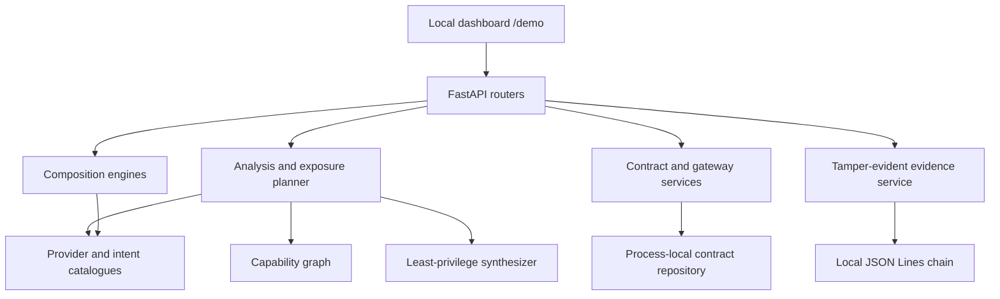
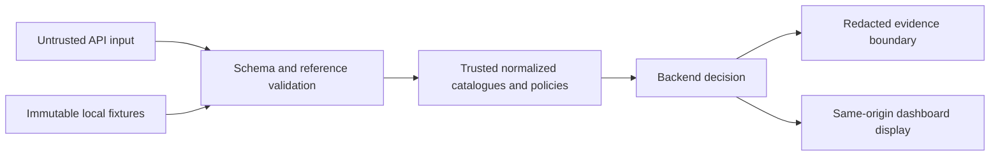
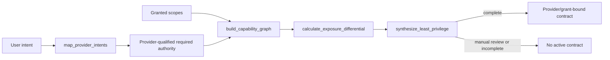
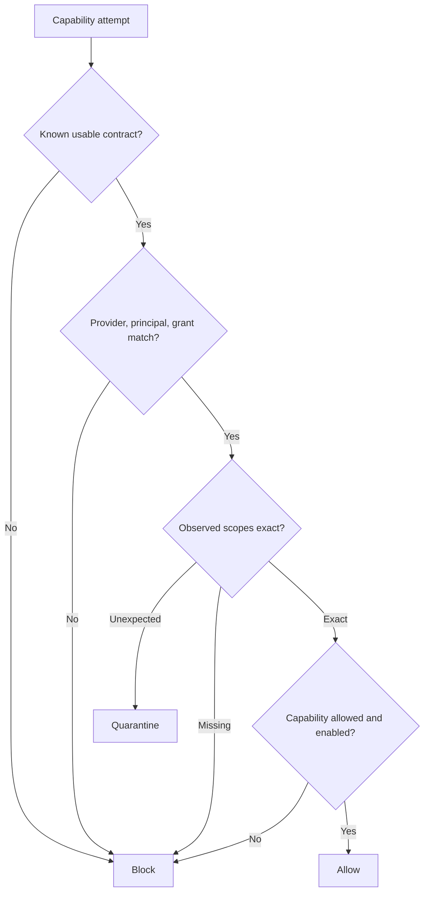
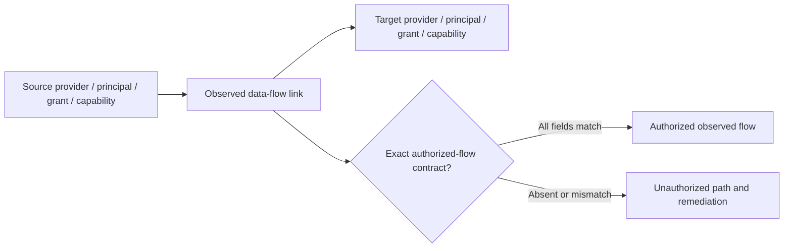
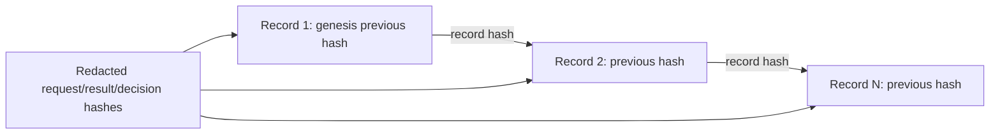
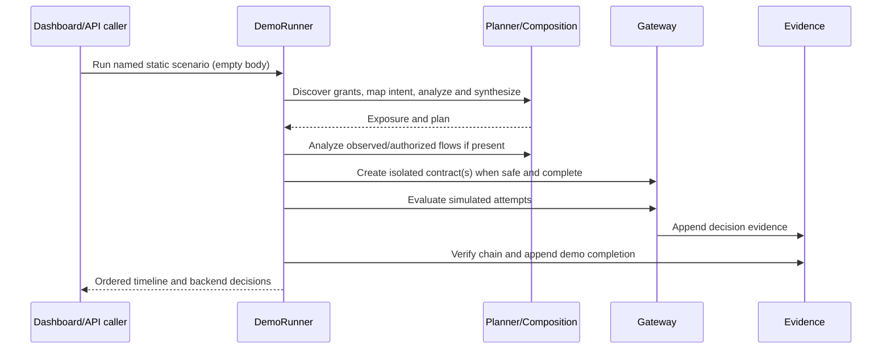

# Architecture and Data Flow

These diagrams describe the implemented local PoC. Synthetic adapters do not contact commercial providers.

## Overall architecture

## Trust boundaries

Untrusted values do not become authority solely because they are syntactically valid. Unknown scopes remain untrusted. Catalogue and fixture correctness is a PoC trust assumption.

## Intent-to-contract workflow

## Runtime gateway workflow

## Cross-provider composition

Observed links represent possible flow, not permission. There are no wildcard authorizations.

## Evidence chain

Verification recomputes every record hash and checks JSON, sequence, genesis, and predecessor continuity.

## Scenario execution sequence

## Module map

- API boundary: `app/api` and `app/main.py`
- Provider identity, catalogue, and fixtures: `app/providers`
- Planning and graphs: `app/planner`
- Contracts and runtime enforcement: `app/gateway`
- Evidence: `app/evidence`
- Demo orchestration: `app/orchestrator/demo_runner.py`
- Evaluation-only baseline and corpora: `app/evaluation`
- Read-only release verification: `app/release`
