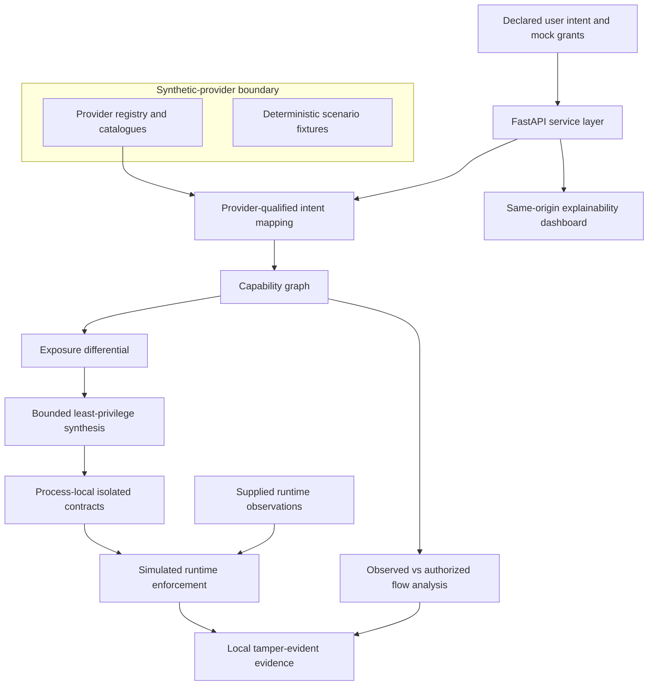
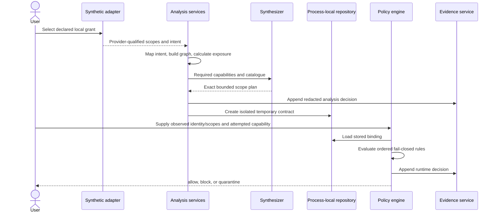
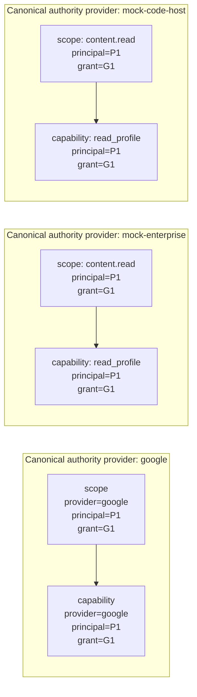
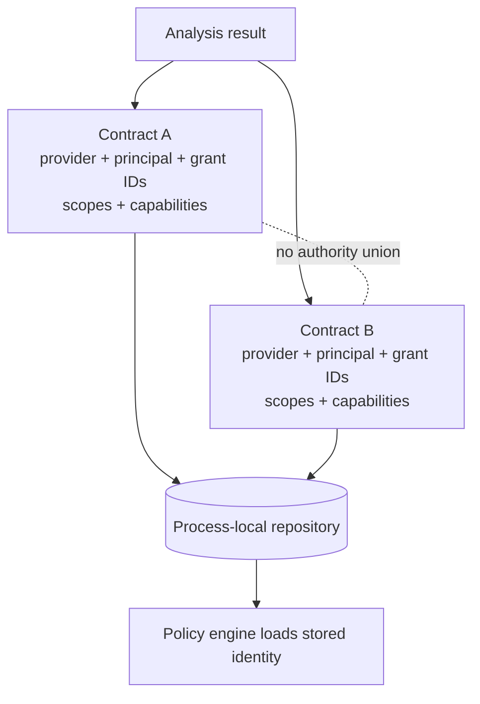
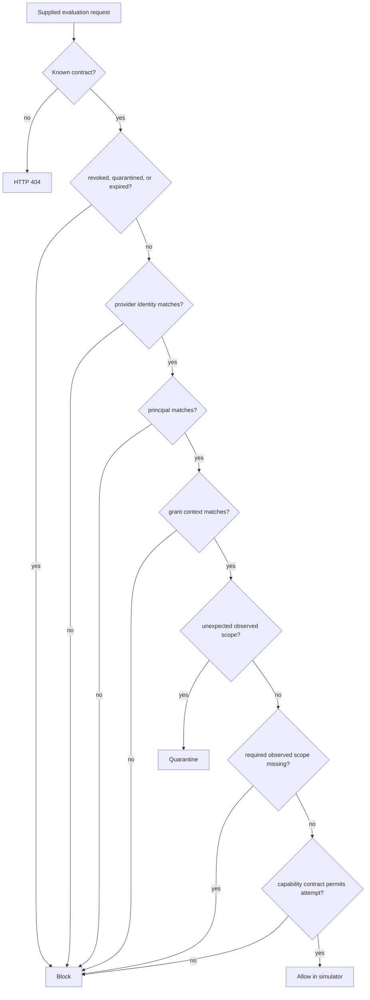
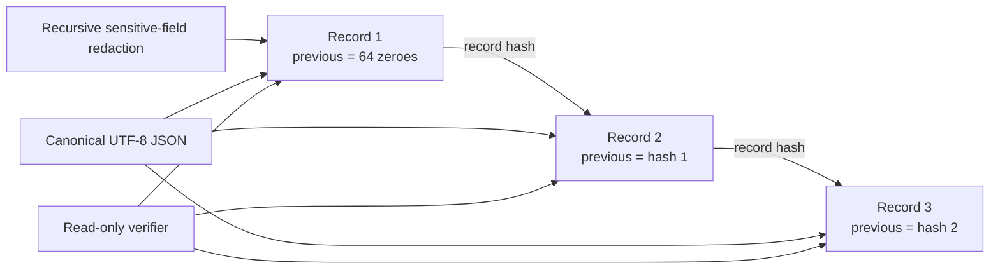

# ScopeSentry-R Submission Diagrams

These reviewed diagrams describe the implemented local proof of concept. Dashed or labelled boundaries distinguish synthetic providers, process-local state, supplied observations, and simulated enforcement. Module references are repository-relative and do not imply real-provider integration.

## Figure 1 — Overall architecture

**Caption.** Implemented pipeline from declared intent to evidence-linked decisions. Synthetic adapters do not contact commercial providers; runtime observations are caller-supplied; contracts are process-local. Implementation: `app/providers/registry.py`, `app/catalogue.py`, `app/planner/`, `app/gateway/`, `app/evidence/`, `app/static/dashboard/`.

## Figure 2 — Processing sequence

**Caption.** The gateway evaluates supplied observations; it does not intercept a real OAuth operation. Implementation: `app/services/analysis_service.py`, `app/planner/least_privilege_synthesizer.py`, `app/gateway/contracts.py`, `app/gateway/policy_engine.py`, `app/evidence/service.py`.

## Figure 3 — Provider-qualified capability graph

**Caption.** Identical textual scope or capability names do not merge authority across canonical providers. NetworkX node IDs are deterministic encodings; structured attributes are authoritative. Implementation: `app/graph/capability_graph.py`, `app/schemas/identity.py`.

## Figure 4 — Contract isolation

**Caption.** Contracts bind one provider/grant authority boundary; unrelated providers are not combined into a global contract. Repository persistence ends with the process. Implementation: `app/gateway/contracts.py`, `app/gateway/repository.py`, `app/services/gateway_service.py`.

## Figure 5 — Runtime decision flow

**Caption.** Identity checks precede scope and capability checks. Unknown or malformed states never default to allow. This is runtime capability-decision enforcement within the credential-free simulator. Implementation: `app/gateway/policy_engine.py`, `app/services/gateway_service.py`.

## Figure 6 — Evidence chain

**Caption.** Each canonical record hashes all record fields except `record_hash` and links to its predecessor. The storage is tamper-evident under documented single-process/local-file assumptions, not tamper-proof. Implementation: `app/evidence/canonical.py`, `app/evidence/hash_chain.py`, `app/evidence/service.py`.

## Diagram interpretation limits

- Synthetic-provider boxes represent local catalogues, not real-provider compatibility.
- “Allow” means a simulator decision, not proof that an external provider operation occurred.
- Composition detection evaluates declared observed links; it is not autonomous network-flow discovery.
- Evidence integrity detects covered mutations during verification but does not protect against privileged replacement of the entire file and trust anchor.
